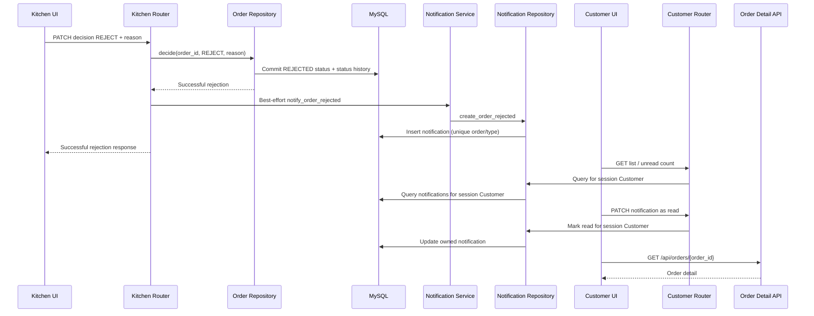

# SaigonBite — REST API Contract, Authentication & Local Setup Guide

**Version:** 1.3 (Customer address-based delivery pricing) | **Backend:** Python + FastAPI | **Database:** MySQL 8 | **Architecture:** MVC-inspired Layered Monolith + Repository Pattern

> **Status:** Describes the API implementation currently documented in this repository. Customer, Kitchen, Admin, and Manager endpoints are documented according to their implemented code. Authentication accounts and sessions remain temporary in-memory demo implementations. Check the current Git branch and commit before using this document as evidence of a specific PR merge or deployment.


---

## 1. Local Setup & Temporary Shared Login

### 1.1 Run Locally

**Linux / macOS (Bash / Zsh / Fish):**

```bash
cd backend
python -m venv .venv
source .venv/bin/activate
pip install -r requirements.txt
uvicorn app.main:app --reload --port 8000
```

**Windows PowerShell:**

```powershell
cd backend
py -m venv .venv
.\.venv\Scripts\Activate.ps1
python -m pip install -r requirements.txt
python -m uvicorn app.main:app --reload --port 8000
```

**Portal & API URLs:**

- Shared Login: `http://localhost:8000/`
- Customer Portal: `http://localhost:8000/customer/`
- Kitchen Portal: `http://localhost:8000/kitchen/`
- Admin Portal (Manage Vouchers): `http://localhost:8000/admin/`
- Manager Portal (Management Reports): `http://localhost:8000/manager/`
- FastAPI Swagger UI: `http://localhost:8000/docs`

Run automated tests from `backend` with:

```bash
python -m pytest -q
```

### 1.2 Temporary Shared Mock Accounts

| Role | Email | Destination |
|---|---|---|
| Customer | configured locally | `/customer/` |
| Kitchen Staff | configured locally | `/kitchen/` |
| Admin | configured locally | `/admin/` |
| Manager | configured locally | `/manager/` |

Override default credentials via environment variables before starting Uvicorn: `SAIGONBITE_CUSTOMER_EMAIL` (one customer email) or `SAIGONBITE_CUSTOMER_EMAILS` (comma-separated customer emails sharing `SAIGONBITE_CUSTOMER_PASSWORD`), `SAIGONBITE_DEMO_EMAIL`, `SAIGONBITE_DEMO_PASSWORD`, `SAIGONBITE_ADMIN_EMAIL`, `SAIGONBITE_ADMIN_PASSWORD`, `SAIGONBITE_MANAGER_EMAIL`, and `SAIGONBITE_MANAGER_PASSWORD`. Each configured customer email must match exactly one row in `customers.email`.

---

## 2. Authentication & Session Specification (Temporary Mock)

The backend maps configured mock credentials to one of `CUSTOMER`, `KITCHEN_STAFF`, `ADMIN`, or `MANAGER`. Any `role` property sent by the browser is ignored; the server assigns the role and redirect destination.

### 2.1 Authentication Endpoints

#### `POST /api/auth/login`

**Request:**

```json
{"email": "<configured-account>", "password": "<configured-password>"}
```

**Response 200:**

```json
{"email": "admin@saigonbite.com", "role": "ADMIN", "demo": false, "redirect_url": "/admin/"}
```

Invalid credentials return HTTP `401`.

#### `POST /api/auth/demo`

Creates a `KITCHEN_STAFF` demo session and returns the same identity payload with `"demo": true`.

#### `GET /api/auth/me`

Returns the active session's `email`, `role`, `demo`, and `redirect_url`. Returns HTTP `401` if unauthenticated.

#### `POST /api/auth/logout`

Invalidates the server-side session and expires the `saigonbite_session` cookie.

### 2.2 Session & Access Control Behavior

- Random session tokens are stored in server memory with an 8-hour TTL (`28800` seconds) and issued via an `HttpOnly`, `SameSite=Lax` cookie named `saigonbite_session` (`SAIGONBITE_COOKIE_SECURE=1` enables `Secure` for HTTPS).
- Protected routes enforce strict role isolation:
  - `KITCHEN_STAFF`: `/kitchen`, `/kitchen/`, `/style.css`, `/app.js`, and `/api/kitchen/*`
  - `CUSTOMER`: `/customer` and `/customer/`
  - `ADMIN`: `/admin`, `/admin/`, and `/api/vouchers/*`
  - `MANAGER`: `/manager`, `/manager/`, and `/api/reports/*`
- Missing sessions return HTTP `401` for `/api/*` routes (or `303` redirect to `/` for UI pages). Authenticated users accessing another role's route receive HTTP `403` for `/api/*` routes (or `303` redirect to their own `role_home` destination for UI pages).
- **Production Note:** Replace the in-memory credential/session store with the MySQL user table, password hashing, and persistent session/token policy before production deployment.

---

## 3. REST API Conventions & Inventory

### 3.1 Conventions

- **Base URL (local):** `http://localhost:8000`
- **Format:** All JSON requests use `Content-Type: application/json`; response JSON uses `snake_case` keys (except UI chart/summary display fields explicitly noted in §8).
- **Types:** Identifiers are positive integers; timestamps use ISO 8601 strings; monetary amounts are nonnegative VND integers (or formatted VND display strings in TV3 UI view models).
- **Error format:** `{"detail": "Human-readable error message"}`
- **HTTP status codes:** `200` GET/PATCH/PUT success; `201` POST created; `204` DELETE/archive success; `400` invalid business input; `401` authentication required; `403` forbidden role; `404` missing resource; `409` illegal state transition/conflict; `422` invalid request format; `500` unexpected server failure.
- **Normalized Order Status Codes:** `PENDING`, `CONFIRMED`, `REJECTED`, `PREPARING`, `READY`, `DELIVERED`, `FAILED`, `CANCELLED` (`READY` displays as “Ready for Pickup” in UI).


### 3.2 API Inventory

| UC | Method | Endpoint | Owner | Purpose |
|---|---|---|---|---|
| Auth | POST | `/api/auth/login` | Shared | Authenticate user and set session cookie |
| Auth | POST | `/api/auth/demo` | Shared | Start Kitchen Staff demo preview session |
| Auth | GET | `/api/auth/me` | Shared | Get current authenticated session info |
| Auth | POST | `/api/auth/logout` | Shared | Clear session and expire cookie |
| UC01 | GET | `/api/hubs` | TV1 | List hubs |
| UC01 | GET | `/api/menu-items?hub_id={id}` | TV1 | List menu items for a hub |
| UC01 | GET | `/api/delivery-options?hub_id={id}` | TV1 | Get selected hub name and address for delivery checkout |
| UC01 | POST | `/api/delivery-quote` | TV1 | Calculate driving distance, delivery fee, and surcharge |
| UC01 | POST | `/api/orders` | TV1 | Place order for the customer bound to the active session |
| UC01 | POST | `/api/customer/vouchers/validate` | TV1 | Validate a global voucher and preview discount/total |
| UC02 | GET | `/api/customer/profile` | TV1 | Resolve current customer profile from active session |
| UC02 | GET | `/api/customer/orders` | TV1 | List current customer's orders |
| UC02 | POST | `/api/customer/orders/{id}/cancel` | TV1 | Cancel an owned order while it is pending |
| UC01 | GET | `/api/customer/vouchers` | TV1 | List active vouchers within their validity dates |
| UC02 | GET | `/api/orders/{id}` | TV1 | Get order detail and current status |
| UC03/04 | GET | `/api/kitchen/orders?hub_id={id}` | TV2 | Kitchen order queue |
| UC03 | PATCH | `/api/kitchen/orders/{id}/decision` | TV2 | Confirm or reject incoming order |
| UC04 | PATCH | `/api/kitchen/orders/{id}/status` | TV2 | Start preparation or mark order ready |
| UC05 | GET | `/api/vouchers` | TV3 | List, filter, and search vouchers |
| UC05 | POST | `/api/vouchers` | TV3 | Create a voucher |
| UC05 | PUT | `/api/vouchers/{id}` | TV3 | Update an existing voucher |
| UC05 | PATCH | `/api/vouchers/{id}/archive` | TV3 | Archive an eligible voucher |
| Admin Delivery | GET | `/api/admin/orders/ready` | TV3 | List orders ready for simulated delivery completion |
| Admin Delivery | PATCH | `/api/admin/orders/{order_id}/deliver` | TV3 | Simulate delivery completion for a READY order |
| UC06 | GET | `/api/reports/sales` | TV3 | Generate Sales Report |
| UC06 | GET | `/api/reports/hub-workload` | TV3 | Generate Hub Workload Report |
| UC06 | GET | `/api/reports/delivery` | TV3 | Generate Delivery Performance Report |


---

## 4. Shared Data Shapes (Proposed)

### 4.1 Order Summary

```json
{
  "id": 101,
  "customer_id": 1,
  "hub_id": 1,
  "status": "PENDING",
  "total": 105000,
  "created_at": "2026-11-01T10:30:00+07:00"
}
```

### 4.2 Order Detail

Example response shape from GET /api/orders/{id}:

```json
{
  "id": 101,
  "customer_id": 1,
  "hub_id": 1,
  "status": "PENDING",
  "total": 103000,
  "created_at": "2026-11-01T10:30:00+07:00",
  "completed_at": null,
  "customer_name": "Nguyen Minh Anh",
  "customer_phone": "0901234567",
  "items": [
    {"menu_item_id": 1, "name": "Chicken Rice", "quantity": 2, "unit_price": 50000, "line_total": 100000}
  ],
  "delivery_address": "123 Nguyen Hue, District 1\nApartment 12\nRecipient: Nguyen Minh Anh\nPhone: 0901234567\nNote: Call on arrival",
  "delivery_distance_km": 1.0,
  "voucher_code": "WELCOME10",
  "payment_method": "COD",
  "payment_status": "UNPAID",
  "subtotal": 100000,
  "delivery_fee": 13000,
  "surcharge": 0,
  "discount": 10000,
  "rejection_reason": null,
  "status_history": [
    {"status": "PENDING", "changed_at": "2026-11-01T10:30:00+07:00", "note": null}
  ]
}
```

The example assumes a hypothetical 1 km route: the delivery fee is calculated as 10,000 VND + 2,500 VND/km, rounded up to the nearest 1,000 VND. Surcharge is separate from delivery_fee. The stored delivery_address starts with the route destination and then includes the submitted contact/delivery details.

---

## 5. TV1 — Customer APIs (UC01 & UC02)

### 5.1 `GET /api/hubs`

**Response 200:**

```json
[
  {"id": 1, "name": "Hub A", "address": "District 1, HCMC", "accepting_orders": true}
]
```

### 5.2 `GET /api/menu-items?hub_id=1`

Required query: `hub_id`.

**Response 200:**

```json
[
  {"id": 1, "hub_id": 1, "name": "Chicken Rice", "price": 50000, "is_available": true}
]
```

### 5.3 POST /api/orders

The Customer must be authenticated. The backend resolves the Customer profile from the authenticated session email and requires exactly one matching customers.email record. The client does not submit customer_id.

Request fields follow CreateOrderRequest:

```json
{
  "hub_id": 1,
  "destination_address": "123 Nguyen Hue, District 1, Ho Chi Minh City",
  "items": [{"menu_item_id": 1, "quantity": 2}],
  "delivery_address": "Apartment 12\nRecipient: Nguyen Minh Anh\nPhone: 0901234567\nNote: Call on arrival",
  "voucher_code": "WELCOME10",
  "payment_method": "COD"
}
```

hub_id and menu_item_id must be positive integers. At least one item is required; quantity is 1 to 50. Both address strings must be 5 to 255 characters. voucher_code is optional or null. payment_method currently accepts COD only and defaults to COD. delivery_address must include nonblank Recipient and Phone lines; Note is optional. The server combines destination_address and delivery_address for storage, and the resulting string must fit the database limit of 255 characters.

The destination_address is used for route calculation. The client does not set an authoritative delivery distance, delivery fee, surcharge, subtotal, discount, or total; the backend calculates those values from the route, current database menu prices, and optional voucher.

Response 201 (CreateOrderResponse):

```json
{
  "id": 101,
  "status": "PENDING",
  "subtotal": 100000,
  "delivery_fee": 13000,
  "delivery_distance_km": 1.0,
  "surcharge": 0,
  "discount": 10000,
  "total": 103000
}
```

The values above are illustrative for a 1 km route, a 100,000 VND item subtotal, and a 10,000 VND voucher discount. Order creation checks that the hub is open, validates item availability and the optional voucher, recalculates the route and totals, and persists the order, order items, and initial status history.

#### GET /api/delivery-options?hub_id=1

Customer-only. Returns information for the selected hub, not a destination list:

```json
{"hub_id": 1, "hub_name": "Hub A", "hub_address": "128 Nguyen Hue, District 1, Ho Chi Minh City"}
```

Returns 404 if the hub does not exist and 400 if it is not open.

#### POST /api/delivery-quote

Customer-only. The frontend calls this when a customer enters or changes the destination address.

Request:

```json
{"hub_id": 1, "delivery_address": "123 Nguyen Hue, District 1, Ho Chi Minh City"}
```

Response 200:

```json
{"delivery_distance_km": 1.0, "delivery_fee": 13000, "surcharge": 0}
```

The backend geocodes the selected hub address and destination address with Nominatim, then asks OSRM for a driving route. It calculates delivery_fee as ceil((10,000 + route_distance_km * 2,500) / 1,000) * 1,000 VND using the unrounded route distance; the response distance is rounded to three decimal places. A separate 3,000 VND surcharge applies only when the route is longer than 5 km. Routes up to and including 10 km are accepted; longer routes are rejected. The fee and surcharge are separate response fields.

A destination that Nominatim cannot resolve or a route OSRM cannot calculate is rejected. Missing/closed hubs are rejected. Provider/network failures are reported as gateway errors. Nominatim and OSRM are public services; availability, rate limits, and address coverage can affect quote generation. Successful geocodes and routes are cached, and requests to each public service are paced.

#### POST /api/customer/vouchers/validate

Customer-only voucher preview. Request fields follow VoucherPreviewRequest:

```json
{
  "code": "WELCOME10",
  "hub_id": 1,
  "destination_address": "123 Nguyen Hue, District 1, Ho Chi Minh City",
  "items": [{"menu_item_id": 1, "quantity": 2}]
}
```

Response 200:

```json
{
  "code": "WELCOME10",
  "subtotal": 100000,
  "discount": 10000,
  "delivery_distance_km": 1.0,
  "delivery_fee": 13000,
  "surcharge": 0,
  "total": 103000
}
```

The backend checks that the hub is open, loads current menu prices, verifies that all requested menu items belong to that hub and are available, calculates the route fee, and validates voucher status, validity dates, minimum item subtotal, and prior use by this Customer. The discount is calculated from the current subtotal and capped at that subtotal. A voucher can be used once per Customer; a later order cancellation does not make it available again. Preview is informational: order creation repeats the checks and recalculates all authoritative order values before saving.

### 5.4 `GET /api/orders/{id}`

**Response 200:** Order detail shape (§4.2) including customer name/phone, items, and `status_history`. The endpoint is shared with Kitchen. Returns `404` if not found or if a Customer session requests an order outside the Customer profile mapped from that session email. The current database schema has no separate customer-note or per-item-options fields.

### 5.5 `GET /api/customer/profile`

Returns the current Customer profile (`id`, `name`, `email`, `phone`) resolved from the active session email. The mapping must match exactly one `customers.email` row; otherwise the endpoint returns `403`.

### 5.6 `GET /api/customer/orders`

Returns only the signed-in Customer's order summaries (§4.1), newest first, with optional `status` filter. The customer ID comes from the resolved session profile rather than a path or query parameter.

### 5.7 `POST /api/customer/orders/{id}/cancel`

Cancels the signed-in Customer's own order only while its status is `PENDING`. The status update and `CANCELLED` history entry are committed together. Returns `404` when the order does not belong to the Customer and `409` if its status has already changed.

### 5.8 `GET /api/customer/vouchers`

Returns vouchers with `ACTIVE` status whose validity window includes the current time and which the signed-in Customer has not used before. Each result includes `code`, `discount_type`, `discount_value`, `min_order`, `valid_from`, and `valid_until`. Voucher minimum order is based on the item subtotal; delivery fee does not count. Each code is limited to one order per Customer, including when the order is later cancelled.

---

## 6. TV2 — Kitchen APIs (UC03 & UC04)

### 6.1 `GET /api/kitchen/orders?hub_id=1&status=PENDING`

Required query: `hub_id`. Optional query: `status` (defaults to kitchen-relevant states `PENDING`, `CONFIRMED`, `PREPARING`, `READY`).

**Response 200:** Array of order summaries (§4.1).

### 6.2 `PATCH /api/kitchen/orders/{id}/decision`

**Request (Confirm):**

```json
{"decision": "CONFIRM"}
```

**Request (Reject):**

```json
{"decision": "REJECT", "reason": "An ingredient is unavailable"}
```

**Response 200:**

```json
{"id": 101, "previous_status": "PENDING", "status": "CONFIRMED", "rejection_reason": null}
```

**Rules:** Only `PENDING` orders can be confirmed/rejected; rejection requires a nonblank reason; invalid/duplicate transitions return `409`; missing order returns `404`.

### 6.3 `PATCH /api/kitchen/orders/{id}/status`

**Request (Start Preparation / Mark Ready):**

```json
{"status": "PREPARING"}
```

```json
{"status": "READY"}
```

**Response 200:**

```json
{"id": 101, "previous_status": "CONFIRMED", "status": "PREPARING"}
```

**Rules:** Only `CONFIRMED → PREPARING` and `PREPARING → READY` transitions are allowed; invalid transitions return `409`.

### 6.4 State Transition Matrix

| Current | Action | Next | UC |
|---|---|---|---|
| `PENDING` | Confirm | `CONFIRMED` | UC03 |
| `PENDING` | Reject + reason | `REJECTED` | UC03 |
| `CONFIRMED` | Start preparing | `PREPARING` | UC04 |
| `PREPARING` | Mark ready | `READY` | UC04 |
| `READY` | Delivered / Failed | `DELIVERED` / `FAILED` | Supporting/demo flow |
| `PENDING` | Cancel | `CANCELLED` | Supporting flow |

---

## 7. TV3 — Admin Voucher APIs (UC05 — Implemented)

Requires an authenticated `ADMIN` session (`401` if unauthenticated, `403` for non-admin roles). Soft-archiving updates status to `ARCHIVED` to preserve historical order references.

### 7.1 `GET /api/vouchers`

**Optional query parameters:**
- `status`: `ALL` (default), `ACTIVE`, `EXPIRED`, or `ARCHIVED`
- `search`: case-insensitive substring match against `code`

**Current schema limitation:** `hub` is a display-only request/response label. The shared `vouchers` table has no hub association, so the label is not persisted or enforced and vouchers currently apply without hub scoping.

**Response 200:**

```json
[
  {
    "id": 1,
    "code": "BITEWELCOME",
    "hub": "All hubs",
    "discount": "20%",
    "min_order": "150,000 VND",
    "valid_from": "01 Nov 2026 –",
    "valid_to": "31 Dec 2026",
    "status": "ACTIVE"
  }
]
```

### 7.2 `POST /api/vouchers`

**Request:**

```json
{
  "code": "SAIGON25",
  "hub": "All hubs",
  "discount": "20%",
  "min_order": 150000,
  "start_date": "2026-11-17",
  "end_date": "2026-12-31"
}
```

**Response 201:** Created voucher object (`status` defaults to `"ACTIVE"`).  
**Errors:** `400` if `code` is blank or `end_date < start_date`; `409` if `code` already exists; `422` if payload validation fails.

### 7.3 `PATCH /api/vouchers/{id}/archive`

**Request:** Empty body.  
**Response 200:** Updated voucher object with `"status": "ARCHIVED"`.  
**Errors:** `404` if voucher ID is not found; `400` if voucher status is not `ACTIVE` (e.g., already `EXPIRED` or `ARCHIVED`).

---

## 8. TV3 — Management Reports APIs (UC06 — Implemented)

Requires an authenticated `MANAGER` session (`401` if unauthenticated, `403` for non-manager roles). All three endpoints accept inclusive `start_date=YYYY-MM-DD` and `end_date=YYYY-MM-DD` query parameters (defaulting to `2026-11-01` through `2026-11-15`) and return `400` when `end_date < start_date`.

### 8.1 `GET /api/reports/sales?start_date=2026-11-01&end_date=2026-11-15`

**Response 200:**

```json
{
  "kpis": [
    {"label": "Total Revenue", "value": "428,500,000 VND"},
    {"label": "Total Orders", "value": "3,420"},
    {"label": "Avg. Delivery Time", "value": "24 mins"}
  ],
  "totalSummary": "Total: 428,500,000 VND · 3,420 orders",
  "rows": [
    {
      "label": "01",
      "date": "01 Nov 2026",
      "orders": 192,
      "revenue": 24000000,
      "chartVal": 24.0,
      "delivery": "24 mins"
    }
  ]
}
```

### 8.2 `GET /api/reports/hub-workload?start_date=2026-11-01&end_date=2026-11-15`

**Response 200:**

```json
{
  "kpis": [
    {"label": "Total Hub Orders", "value": "3,420"},
    {"label": "Completed Orders", "value": "3,318"},
    {"label": "Avg. Prep Time", "value": "11 mins"}
  ],
  "totalSummary": "Total: 3,420 orders · 97.0% completion rate",
  "rows": [
    {
      "label": "D1",
      "col1": "District 1 Central Hub",
      "col2": "1,120",
      "col3": "1,092",
      "col4": "28",
      "chartVal": 1120
    }
  ]
}
```

### 8.3 `GET /api/reports/delivery?start_date=2026-11-01&end_date=2026-11-15`

**Response 200:**

```json
{
  "kpis": [
    {"label": "Total Deliveries", "value": "3,318"},
    {"label": "On-Time Rate", "value": "94.6%"},
    {"label": "Avg. Delivery Time", "value": "24 mins"}
  ],
  "totalSummary": "Total: 3,318 deliveries · 94.6% on-time",
  "rows": [
    {
      "label": "01",
      "col1": "01 Nov 2026",
      "col2": "188",
      "col3": "179 (95.2%)",
      "col4": "24 mins",
      "chartVal": 95.2
    }
  ]
}
```

---

## 9. Optional Supporting Endpoints, DB Rules & Checklist

### 9.1 Optional Supporting Endpoints (Require Team Approval)

| Method | Endpoint | Purpose | Proposed Owner |
|---|---|---|---|
| GET | `/api/orders/{id}/history` | Standalone status timeline if not included in order detail | TV1 |
| GET | `/api/vouchers/{id}` | Single voucher details if list data is insufficient | TV3 |
| GET | `/api/health` | Local backend health check | TV2 (foundation) |

### 9.2 Database Dependencies & Integration Rules

- **TV3 Database:** `orders`, `order_items`, `order_status_history`, `menu_items`, `hubs`, `vouchers`, `deliveries`, and supporting tables defined in `database/schema.sql`.
- **Cross-Module Persistence:** Customer-created orders (PENDING) are stored in the shared database and appear in Kitchen with the same ID. Kitchen status changes and history are visible through the shared /api/orders/{id} detail endpoint. Voucher and report repositories also use the shared SQLAlchemy models. Customer delivery distance and charges use Nominatim geocoding and an OSRM driving route; public-service availability, rate limits, and address coverage can affect quote generation. Manager delivery-time reporting depends on pickup_at and delivered_at timestamps; see docs/INTEGRATION_ISSUES.md.
- **Transaction Boundary:** Every status transition must atomically persist both order status and `order_status_history` within a single transaction.

### 9.3 Team Approval Checklist

- [x] **TV3:** Implemented Admin Voucher APIs (`/api/vouchers`) and Manager Report APIs (`/api/reports/*`) with role-protected routes and Figma-aligned portals.
- [x] **TV3:** Bound voucher and report endpoints to MySQL 8 SQLAlchemy ORM models (`schema.sql` / `seed.sql`).
- [ ] **TV1:** Confirm `POST /api/orders` request/response, hub/menu fields, and UC02 history shape.
- [ ] **TV2:** Confirm kitchen `decision`/`status` bodies and allowed transitions.
- [ ] **All:** Confirm IDs, timestamps, VND representation, error format, and access-control policy before freezing the shared contract.

## 10. TV2 In-app Notifications (Kitchen Rejection - Customer)

This contract is implemented on `feature/tv2-notification`, based on integration commit `b4db250`. It is not available on the integration branch until reviewed and merged, and requires the additive notifications migration before MySQL use.

All three endpoints require a signed-in Customer session. The backend resolves the Customer profile from the session email; clients must not submit a `customer_id`.

### 10.1 `GET /api/customer/notifications`

Returns the current Customer's notifications, newest first:

```json
[
  {
    "id": 1,
    "order_id": 501,
    "notification_type": "ORDER_REJECTED",
    "title": "Order #501 was rejected",
    "message": "Your order was rejected. Reason: Unavailable ingredients",
    "is_read": false,
    "created_at": "2026-11-21T09:30:00+00:00"
  }
]
```

`created_at` is serialized as an ISO 8601 UTC timestamp with an explicit offset. The response does not expose `customer_id`.

### 10.2 `GET /api/customer/notifications/unread-count`

```json
{"unread_count": 1}
```

### 10.3 `PATCH /api/customer/notifications/{notification_id}/read`

No request body is required. The endpoint only updates a notification owned by the session Customer.

```json
{"id": 1, "is_read": true}
```

Returns `401` without a valid session, `403` when the session role/profile is not a valid Customer, and `404` for a missing notification or one owned by another Customer.

### 10.4 Persistence and migration

The `notifications` table is defined in `database/schema.sql`, the SQLAlchemy `Notification` model, and `database/migrations/20261121_create_notifications.sql`. It stores `notification_id`, `customer_id`, `order_id`, `notification_type`, `title`, `message`, `is_read`, and `created_at`. Foreign keys point to `customers` and `orders`; `(order_id, notification_type)` is unique to prevent duplicate notifications of the same type for one order. Customer/time and Customer/read indexes support list and unread-count queries. The migration declares server-side defaults; the ORM currently declares equivalent Python-side defaults rather than `server_default`, so direct SQL inserts rely on the migration's defaults.

For a **new or disposable database**, initialize with `database/schema.sql` and then `database/seed.sql`. The schema script begins with `DROP DATABASE IF EXISTS SaigonBiteDB`; do not run it on an existing/shared database. An existing database should be upgraded with the additive notifications migration only, after selecting and verifying the intended database. That migration currently contains `USE SaigonBiteDB;`, so for isolated testing use a temporary copy with `USE` changed to the disposable database name and verify it with `SELECT DATABASE()` before execution. Neither path has been run for this feature.

### 10.5 Kitchen rejection notification flow



Order status/history and notification are separate transactions by design: notification storage failure is logged and does not fail or undo the successful rejection. This best-effort behavior can leave a rejected order without a notification if storage fails; a retry of the rejection is an invalid status transition and does not repair that missing notification.

### 10.6 Review and verification status

TV1 confirmation is pending for the Customer bell, dropdown, read interaction, and order-detail navigation. The unread count refreshes at page initialization, when opening the panel, and after marking an item read; no live refresh occurs while the panel is closed because polling is not part of this feature. TV3 confirmation is pending for the shared database schema/migration and integration architecture. MySQL migration/E2E, browser E2E, and concurrent MySQL insert/transition tests have not been completed. See `docs/INTEGRATION_ISSUES.md` for current test evidence and remaining work.
